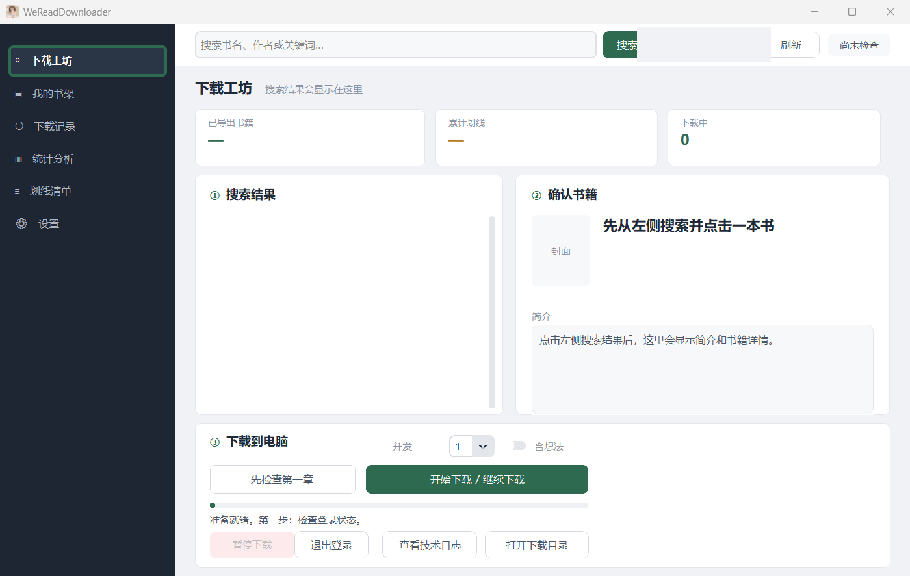
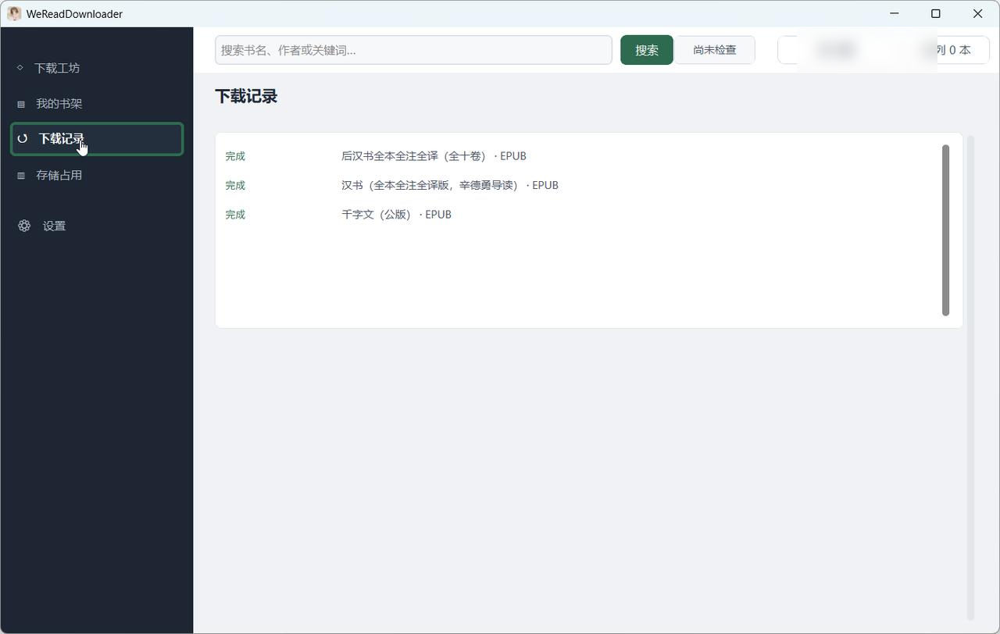

# WeReadDownloader

把微信读书里的书导出成 EPUB。正文按章节抓取、可断点续传；划线留在正文，注释和想法按你选的方式收进书末附录；一次可以排队下载多本。

Windows 桌面程序，Tk 图形界面，下载引擎是一个独立的 worker 进程。



> 导出的内容版权归原作者和出版社，请只用于自己阅读。详见[免责声明](#免责声明)。

---

## 功能

- **搜索下载**：书名/作者搜索，选中后先试读第一章确认协议可用，再开始整本下载。
- **书架下载**：直接列出微信读书账号里的书，点一下就能下载。
- **断点续传**：章节、图片、划线数据逐章落盘；中断后继续下载不会从头再来。
- **排队下载**：勾选多本加入队列，按顺序自动下载；可暂停在当前这本、可跳过某本、结束时汇总未完成的书。
- **四种标注方式**：注释和想法 / 注释 / 想法 / 纯正文。
- **统一附录**：注释与想法收进书末分册，正文只留可点的角标。
- **缺失说明**：书里少了什么（缺图、未定位的划线）写进 `manifest.json`，下载完成时也会提示。
- **体积控制**：插图按内容去重；图片与正文共用一个压缩包，不给同一本书存第二份。

---

## 下载安装

系统要求：Windows 10 / 11（64 位）。

从 [Releases](../../releases) 下载 `WeReadDownloader-Setup.exe` 双击安装。安装向导只问安装位置（默认 `C:\Program Files\WeReadDownloader`）和是否创建桌面快捷方式；主程序与下载组件一起安装。

数据目录固定在本机，不跟随安装位置：

```
%LOCALAPPDATA%\WeReadDesktop\
├── exports\      # 导出的书
├── logs\         # 日志
├── weread-live-settings.lua   # api_key
└── session-cookies.json       # 扫码会话（DPAPI 加密）
```

升级或重装程序不会动这个目录。

---

## 快速开始

1. 安装并打开程序。
2. 点右上角账号按钮，按提示完成登录（见[登录](#登录)）。
3. 在顶栏搜索书名，点搜索结果里的一本。
4. 点「先检查第一章」，确认能取到正文。
5. 点「开始下载 / 继续下载」。

下载进度、当前章节和缺失说明都在「③ 下载到电脑」卡片里。

---

## 界面

左侧五个页面：

| 页面 | 用途 |
|---|---|
| 下载工坊 | 搜索、确认书籍、下载；排队下载 |
| 我的书架 | 微信书架直接下载；管理本机已导出的书 |
| 下载记录 | 每本书的下载结果 |
| 存储占用 | 导出目录占了多少、哪些目录可以回收 |
| 设置 | 下载/日志目录、账号、标注方式说明、检查更新 |



### 下载工坊

页面分三块，从左到右：

- **① 搜索结果**：搜索结果卡片，可勾选多本加入队列；每页 6 本，用底部翻页条切换。
- **② 确认书籍**：封面、作者、分类、出版社、出版时间、评分、书籍 ID 和简介。选错版本时看这一栏。
- **③ 下载到电脑**：标注方式、先检查第一章、开始/继续下载、暂停、退出登录、查看技术日志、打开下载目录。

### 我的书架

上半部分「微信书架」是账号里的书，点书名或「下载」直接进入下载确认。右上角「刷新书架」重新拉取。

下半部分「本机已导出」是这台电脑上的成品，按书列出：

- **打开**：在资源管理器里打开导出目录。
- **删想法**：删除 `reviews.jsonl`（想法与划线原始数据），EPUB 保留。
- **删除**：删除整本书的导出目录。
- **全部清理**：回收未完成/半成品/残留目录，不影响已完成的 EPUB。

### 下载记录

按时间列出每本书的结果：完成的书会标出产物类型（EPUB），未完成或失败的也会出现在这里。数据来自日志文件，可以随时清理。

### 存储占用

显示已完成的书数、想法数据体积、导出目录总占用和可回收空间。可回收部分就是「我的书架 → 全部清理」会删掉的那些目录。

### 设置

- 下载目录、技术日志目录的路径和「打开文件夹」。
- 登录：说明凭证保存位置与退出登录的两个范围。
- 标注方式：默认档位与含义。
- 版本与更新：显示当前版本，检查更新（覆盖安装会保留导出与登录信息）。

---

## 标注方式

下载区右上角的「标注方式」决定成品保留哪些内容：

| 标注方式 | 划线 | 注释 | 想法 |
|---|---|---|---|
| **注释和想法**（默认） | 有 | 书末附录 | 书末附录 |
| **注释** | 有 | 书末附录 | 无 |
| **想法** | 有 | 无 | 书末附录 |
| **纯正文** | 无 | 无 | 无 |

**附录怎么排**：正文里只保留角标——注是「注」字角标，想法是蓝色 `[N]`——点角标跳到书末对应的条目，条目上的编号可以跳回原文。注按约 3000 条一册分批，想法单独一册，和普通章节一起出现在目录里，不占用阅读位置。

**各档的差别**：

- 「注释」不拉取想法数据；正文里原有的想法角标不会再指向附录。
- 「想法」只收想法；注释不导入正文，也不生成注册。
- 「纯正文」连 `/book/underlines` 与 `/book/readreviews` 两个接口都不请求，每章少两个网络往返，是四种里最快、体积最小的。

**换挡的代价**：标注方式按书保存。下载中途不能改；下载完成后再换挡会重新取章节正文（断点里的旧章节是按旧模式注入的，需要重取）。

**用什么阅读**：想看注释和想法，推荐使用 [Readest](https://readest.com)——附录、角标跳转在它上面的表现经过实际验证；其他阅读软件对这类 EPUB 结构的适配程度可能不一样，角标跳转或附录排版未必正常。

---

## 排队下载

1. 在搜索结果里勾选多本（卡片上的「加入队列」）。
2. 点结果区右上角「加入队列 N 本」。
3. 点顶栏「队列」打开队列面板，点「开始队列下载」。

| 操作 | 行为 |
|---|---|
| 开始队列下载 | 从队首一本一本下载，每本结束后自动开始下一本 |
| 暂停下载 | 停在当前这本：写盘保留、书插回队首、按钮变「继续队列」 |
| 继续队列 | 从队首那本继续，已下载的章节续传 |
| 下载中取消勾选 | 轮到时跳过这本，不打断当前任务 |
| 移除 / 清空队列 | 只在队列未运行时可用（运行中先暂停） |

队列结束时，如果所有书都完成，状态栏写「队列已全部完成」；有书没完成时列出书名和原因。未完成的书保留断点，可以在书架里点那本书继续。

---

## 导出结果

```
%LOCALAPPDATA%\WeReadDesktop\exports\
└── 书名-书籍ID\
    ├── 书名 - full.epub     # 成品，可直接阅读
    ├── manifest.json        # 章节清单 + 本书的缺失说明
    ├── reviews.jsonl        # 划线落点与想法原始数据
    └── bundle.json          # 上面几个文件的索引
```

- **EPUB**：唯一成品。拷进任何支持 EPUB 的阅读器即可；附录、目录、角标跳转都在文件里。
- **manifest.json**：章节顺序与 UID、`omissions`（这本书缺了什么）、附录文件清单。
- **reviews.jsonl**：每章的划线区间、选中文字、想法正文。删除它不影响已生成的 EPUB（「我的书架 → 删想法」做的就是这件事）。
- **bundle.json**：指向上述文件的相对路径，供工具读取。

`omissions` 里常见的字段：

| 字段 | 含义 |
|---|---|
| `text_complete` | 正文是否完整（缺章时不会发布 EPUB） |
| `images_dropped` / `chapters_with_dropped_images` | 服务端已删除或缺图的图片数与涉及章节 |
| `images_dropped_note_markers` | 其中属于「注」角标图（note.png）的数量；注文本身已保留 |
| `underlines_not_placed` / `chapters_with_unplaced_underlines` | 原文里找不到可用位置、被略去的划线条数与章节 |
| `unplaced_underline_details` | 上面这些划线的章节与区间（最多 200 条） |

单张图片超过 64 MiB 时会跳过该图并计入缺失，不会让整章失败。

**日志位置**：`%LOCALAPPDATA%\WeReadDesktop\logs\`。反馈问题时连同 `desktop-general.log` 和对应书的日志一起提供。

### 关于 KOReader 导入（实验性）

仓库里的 `plugins/weread-importer.koplugin` 是一个实验性的 KOReader 导入插件，可以把上面的导出目录装进 KOReader 书库。使用前请清楚三件事：

- **不随安装包发布**，也不在任何支持范围内；想尝试需要自己把目录装进 KOReader。
- 目前**只支持「纯正文」档**导出的书；带统一附录（注释/想法）的成品它处理不了。
- 插件仍在开发中，划线弹窗与书库界面尚未完整验收，随时可能变动。

---

## 登录

微信读书没有给第三方"扫码后自动下发 `api_key`"的接口，所以第一次需要两个步骤：

1. **拿一次 `api_key`**：浏览器打开 [weread.qq.com/r/weread-skills](https://weread.qq.com/r/weread-skills)，登录后复制页面给出的 `api_key`（形如 `wrk-...`）。
2. **在程序里扫码**：点右上角账号按钮 →「扫码」，用微信确认。程序会把 `api_key` 和扫码得到的会话一起保存。

| 文件 | 内容 | 有效期 |
|---|---|---|
| `weread-live-settings.lua` | `api_key` | 长期，除非在微信读书网页版「注销其它设备」 |
| `session-cookies.json` | 扫码会话，Windows DPAPI 加密 | 会过期，重新扫码即可 |

两个文件都在 `%LOCALAPPDATA%\WeReadDesktop\`。

**退出登录**有两个范围：

- **仅退出会话**：只删 `session-cookies.json`；`api_key` 保留，下次打开点一次扫码即可。
- **彻底清除**：两个文件都删，下次需要重新扫码并重抄一次 `api_key`。

凭证只存放在本机：不进日志、不进导出目录、不进仓库。仓库的 `pre-push` 钩子会在每次推送前扫描硬编码密钥与凭证文件。

---

## 数据与网络

- 程序只与本机 worker 进程通信；worker 直接访问微信读书接口，不经过任何第三方服务器。
- 导出、日志、凭证全部在本机。程序不上传书籍内容、阅读记录或账号信息。
- 自更新检查会访问 GitHub Releases 读取版本号；在设置页手动触发，失败不影响下载。

---

## 常见问题

**下载卡在「正在准备下载…」**
worker 启动、登录校验和断点扫描需要几秒；首次安装后系统扫描新程序可能更久。超过一分钟仍无进度时，打开「查看技术日志」，看最后一条 `[SPAWN]` 或 `FAILED` 记录。

**有些划线没有出现在书里**
微信读书给不出这条划线在原文里的位置时，程序会略去它而不是标错句子。数量与章节写在完成提示和 `manifest.json` 的 `omissions` 里。

**书里少了几张图**
微信读书服务端已删除的图片无法取回；超过 64 MiB 的单张图会被跳过。两种情况都计入 `omissions`，正文不受影响。

**队列里某本没完成**
已下载的章节保留。在「我的书架」里点那本书继续下载即可，会从断点续传。

**换电脑怎么迁移**
把 `%LOCALAPPDATA%\WeReadDesktop\` 整个目录拷过去即可，导出、凭证、日志都在里面。凭证用 DPAPI 加密，只在原机器上可解；换机器后需要重新扫码（`api_key` 可以继续用）。

**登录过期了怎么办**
状态灯显示「需要登录」时点账号按钮重新扫码，导出目录和断点头不受影响。

---

## 已知限制

- 同一时间只有一个下载任务；队列是一本接一本串行执行。
- 切换标注方式会重新取章节正文（断点保留，但不沿用旧模式的缓存）。
- 划线定位依赖微信读书返回的字符区间；拿不到区间的划线会被略去。
- 古文注释里的「注」收集进附录，正文中保留「注」角标；个别书版的特殊排版元素可能无法原样还原。

---

## 关于 Kindle 插件适配

目前不考虑做微信读书的 Kindle 阅读器适配插件：做同类适配的开发者已经很多，重复投入意义不大。

推荐使用 **kindle-weread**，更新快，适配的机型和固件版本也更多。相关问题可以加 QQ 群 **1131949335** 交流。

本程序只负责把账号里的书导出成 EPUB，导出后可以自己放进 Kindle 或任意支持 EPUB 的阅读器。

---

## 开发与构建

仓库结构：

| 路径 | 内容 |
|---|---|
| `weread/desktop_app.py` | Tk 图形界面 |
| `weread/weread_desktop.py` | 导出引擎（协议、抓取、打包、附录） |
| `weread/weread_worker.py` | 进程入口：引擎模式与扫码登录模式 |
| `weread/unified_appendix.py` | 「注释和想法」附录生成与校验 |
| `packaging/*.spec` | 两个 PyInstaller 打包描述（GUI / worker） |
| `installer/WeReadDesktop.iss` | Inno Setup 安装脚本 |
| `tests/` | Python 测试 |

测试：

```
python -m pytest -q
```

需要外部 Lua 插件目录的用例（`WEREAD_KINDLE_ROOT` 指向 Kindle 目录）在缺失时会跳过。

打包：

```
pyinstaller --distpath release-fresh --workpath build-fresh-gui packaging/WeReadWorker.spec
pyinstaller --distpath release-fresh --workpath build-fresh-gui packaging/WeReadDesktop.spec
"%LOCALAPPDATA%\Programs\Inno Setup 6\ISCC.exe" installer/WeReadDesktop.iss
```

产物：`release-installer\WeReadDownloader-Setup.exe`。

命令行（调试用）：`WeReadWorker.exe` 支持 `--search`、`--book-info`、`--shelf`、`--check-auth`、`--probe-book`，以及带书 ID 的整本导出（`--jobs`、`--no-annotations`、`--no-thoughts`、`--unified-appendix`、`--appendix-scope`）。

---

## 免责声明

使用本程序前请完整阅读以下条款；继续使用即视为你已理解并接受全部内容。

1. **遵守服务条款**。使用本程序即表示你承诺遵守《微信读书用户服务协议》及腾讯的相关规则。本程序通过你自己的登录凭证访问微信读书接口，抓取导出的行为**可能超出微信读书允许的使用范围**；由此引发的账号功能受限、降权、**封禁**或其他任何处罚，风险由使用者自行承担，**作者与贡献者不承担任何责任**，也无法为你恢复账号。
2. **个人使用边界**。导出的内容（书、划线、注释和想法）版权归原作者与出版社所有。成品仅限你本人学习、研究使用；请勿传播、分享、转载或用于任何商业用途。
3. **按现状提供**。本程序不附带任何明示或默示的担保，包括但不限于可用性、准确性或不中断。因使用或无法使用本程序造成的任何直接或间接损失（含数据丢失、账号损失），作者与贡献者不承担责任。
4. **自担频率风险**。请使用你自己的账号登录；请求过密可能触发微信读书的访问频率限制或风控。
5. **随时停止**。若你不接受以上任何一条，请立即停止使用并删除本程序及全部导出内容。
6. **无隶属关系**。本项目为独立的开源工具，与腾讯、微信读书均无隶属、合作或授权关系。
