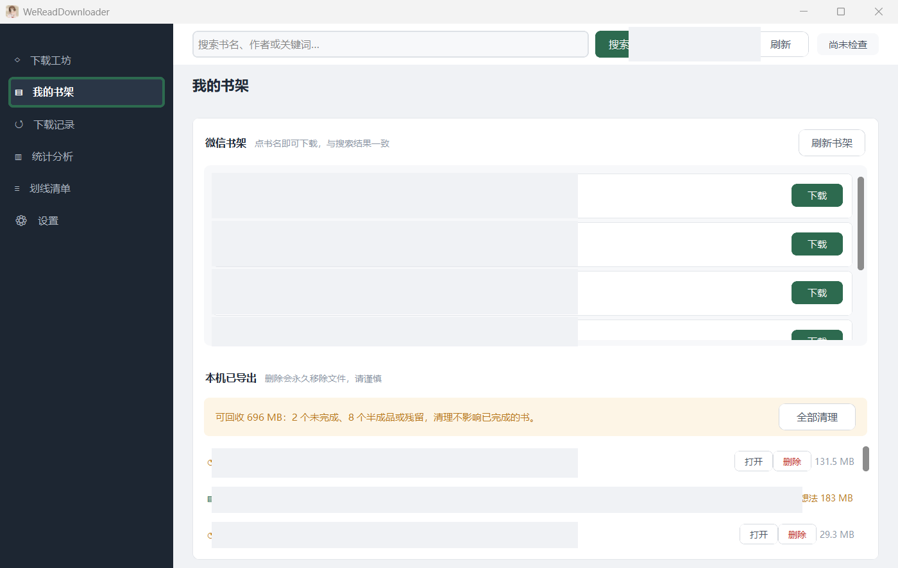

# WeReadDownloader

把微信读书里的书导出成 EPUB，**划线一条不丢**，可断点续传，也能导入 Kindle 上的 KOReader。


> 请先看[免责声明](#免责声明)。简单说：导出的书版权归原作者所有，只用于你自己阅读。

---

## 下载安装

从 [Releases](../../releases) 下载 `WeReadDownloader-Setup.exe`，双击安装。

安装向导只有两个选项：装到哪（默认 `C:\Program Files\WeReadDownloader`），
以及要不要在桌面放快捷方式。

---

## 怎么用

左侧是导航，下载相关的都在「下载工坊」页；「我的书架」「下载记录」「统计分析」
「划线清单」是另外四个页，下面分别说。

「下载工坊」页本身分三步，从左到右、从上到下依次完成：


**① 搜索** —— 顶栏输入书名或作者，点「搜索」，结果出现在左侧「① 搜索结果」。

**② 确认** —— 点搜索结果里任意一本，右侧「② 确认书籍」会显示封面、分类和简介。
这一步是在确认程序拿到了这本书的正确版本，避免下错书。

**③ 下载** —— 点「先检查第一章」。这一步会真的去取第一章正文并验证协议是否可用，
**几十秒后就退出，不会开始下载整本书**。确认没问题再点「开始下载 / 继续下载」。

> 中途关掉或断网都不要紧。重新下载同一本书会从上次停下的章节继续，不会从头再来。

### 我的书架：直接从账号里挑书

不用搜书也可以 —— 「我的书架」页直接列出你微信账号里的真实书籍，点书名或「下载」即可。
上半部分是微信书架（你正在读的书），下半部分是「本机已导出」（已经导到电脑上的书，
可以打开、删想法、删除、清理半成品）。



> 截图里的书名和封面做了遮挡，原图是账号的真实书架。

### 标注：三个选项

下载区右上角有一个标注下拉框，三个选项对应三种导出结果：

|  | 划线 | 你写的笔记 |
|---|---|---|
| **注释和想法**（默认） | 有 | 有，收在书末「注释和想法」附录 |
| **只要划线** | 有 | 没有 |
| **纯正文** | 没有 | 没有 |

**注释和想法**是默认档：正文只留角标——注是橙色圆点「注」，想法是蓝色 `[N]`——
点角标跳到书末的「注释和想法」附录。附录里注按约 3000 条分册，想法单独一册，
都出现在目录里，可以像普通章节一样翻。

「只要划线」省的体积来自每条想法附带的作者资料、书籍记录、话题和时间戳，定位时用不上
这些。

「纯正文」连划线都不要，因此连 `/book/underlines` 和 `/book/readreviews` 两次请求都
不发——每章省两个来回，是三者里最快、体积最小的。

---

## 下载结果在哪

```
%LOCALAPPDATA%\WeReadDesktop\exports\
└── 书名-书籍ID\
    ├── 书名 - full.epub           # 可直接阅读，含划线
    ├── 书名 - full.weread.zip     # 导入 KOReader 用的包（见下）
    ├── manifest.json              # 章节清单 + 本书缺了什么
    └── reviews.jsonl              # 划线落点与想法（关掉开关则没有）
```

`manifest.json` 里的 `omissions` 会**明说这本书少了什么**（比如某章图片没取到）。
程序宁可降级也不失败，所以偶尔会有缺图缺章 —— 清单里写着，不会让你以为书是完整的。

**日志位置**：`%LOCALAPPDATA%\WeReadDesktop\logs\`（反馈问题请连同这个目录一起提供）

---

## 导入 Kindle

导出的 `书名 - full.weread.zip` 是给 KOReader 用的。**Kindle 原生系统不支持它**，
需要配合 KOReader 的微信读书相关插件使用。

> **现状说明**：KOReader 侧的导入插件（含独立迷你导入器）仍在开发打磨中，
> 暂未发布可用版本。现在导出的 `.weread.zip` 可以先留好，等插件发布后直接导入；
> EPUB 正文本身（`书名 - full.epub`）不依赖插件，拷进 KOReader 就能看，只是
> 划线想法的回贴暂不可用。

### 包里有什么

普通 EPUB 的划线写在书里的标注层，但微信读书的划线多带了两样东西，EPUB 装不下：
一条划线可能还挂着你写的笔记，以及它在原文里的落点（一段字符区间，不是页码）。

所以 `.weread.zip` 里，书和划线是分开放的：

| 文件 | 作用 |
|---|---|
| `书名 - full.epub` | 正文，划线锚点已经打进去 |
| `reviews.jsonl` | 每条划线的区间、选中文字、笔记正文 |
| `manifest.json` | 章节清单、缺失说明 |
| `bundle.json` | 索引，指明上面三个文件叫什么 |

导入器发布后，会读 `bundle.json` 取出书装进书库，再按 `reviews.jsonl` 里的区间把
划线贴回去，点开划线还能看到你当时写的笔记。

---

## 登录

**两步，共一分钟：**

1. **拿一次 `api_key`（只做一次，长期有效）**
   - 浏览器打开 [weread.qq.com/r/weread-skills](https://weread.qq.com/r/weread-skills)
   - 登录后页面会给你一个 `api_key`（形如 `wrk-...`），复制下来

2. **打开程序，扫码登录**
   - 点右上角账号按钮 → 「扫码」→ 微信扫一扫确认
   - 程序自动把 `api_key` 和扫码得到的 `wr_skey` 一起存好
     （cookie 用 Windows DPAPI 加密），不需要你手动建任何文件

| 东西 | 来源 | 存哪 | 过期/失效 |
|---|---|---|---|
| `api_key` (`wrk-...`) | 网页版手动抄 | `weread-live-settings.lua`（登录时自动创建） | 长期有效，除非你在网页版“注销其它设备” |
| `wr_skey` / cookie | 扫码登录 | `session-cookies.json` (DPAPI 加密) | 会过期，重新扫码即可 |

**退出登录** 只删扫码 cookie，`api_key` 留着，下次打开不用重新扫码。想彻底
清净，手动删两个文件：
```
%LOCALAPPDATA%\WeReadDesktop\session-cookies.json
%LOCALAPPDATA%\WeReadDesktop\weread-live-settings.lua
```

> **为什么还要抄一次 `api_key`？** 微信读书官方没给第三方“扫码后自动下发
> `api_key`”的接口，只给扫码换 `wr_skey`。所以第一次必须去网页版抄一次，
> 之后程序会在每次登录时自动维护这两个文件——包括全新安装，扫码即可用。

凭证用 Windows DPAPI 加密后存在本机，**不进日志、不进安装包、不进仓库**。
仓库里有一条 pre-push 钩子，每次推送前自动扫描硬编码密钥和凭证文件。

---

## 免责声明

导出的书、划线和想法，版权仍属于原作者和出版社。程序只把你账号里已有的内容搬到
本地，不会让你获得任何额外授权。请自用，不要分享或传播。

用你自己的账号登录，请求过密可能触发微信读书限流，风险自己承担。软件按现状提供，
不保证可用；重要的书请自己留好原始备份。

本项目与腾讯、微信读书均无隶属关系。

---

## 已知限制

- **古文注释的「注」角标不支持**：像《后汉书》这类书，原文里夹带的「注」是
  微信读书的特殊排版元素，导出的 EPUB 里只保留正文，注角标和注的内容不会出现。
- 一本书同一时间只能有一个导出任务在跑
- 标注选「只要划线」时，想法数据仍会从服务器拉取（划线落点依赖它），只是不写入成品
- 「彻底清除凭证」会连基础凭证一起删，之后需重新扫码 + 重抄一次 `api_key`（见登录一节）

### 以后也许会做的

- **排队下载**：一次勾多本，按顺序依次下载。现在只能一本跑完再开下一本。导出锁是按书
  放的（`exports/书名-ID/export.lock`），不同书之间并不冲突，所以排队在技术上没有障碍，
  缺的是队列本身。
- **古文注释**：「注」角标及其内容能否导入 EPUB，取决于 CRE 引擎对这类微信读书
  特殊元素的支持程度，需要调研。
